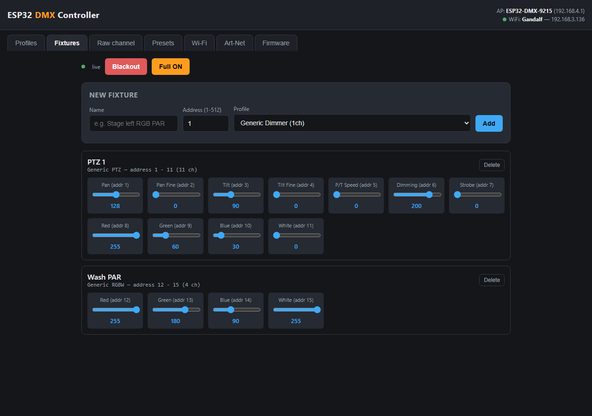
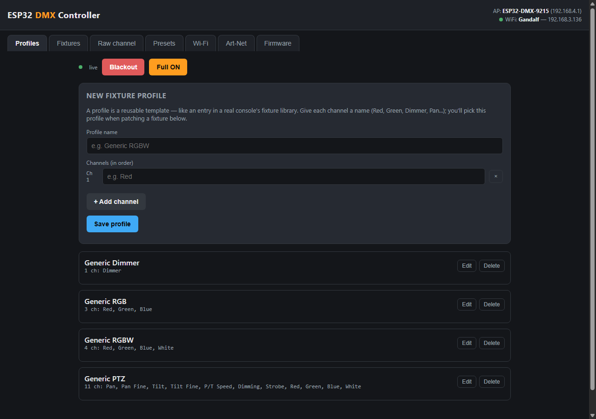
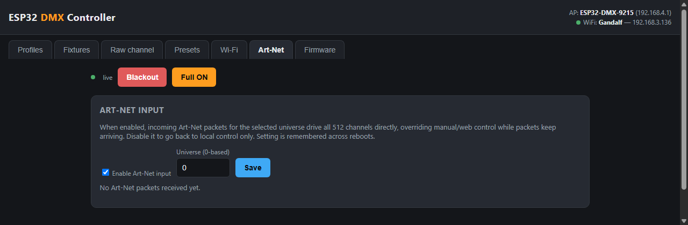

# ESP32 DMX Controller

A small, self-contained **DMX-512 lighting controller** built around a cheap
ESP32-C3 board. No app to install, no cloud account, no internet required:
plug it in, connect to its Wi-Fi, and control your lights from a web page —
just like a real lighting console, but for the price of a coffee.

## Features

- 🎛️ **Web-based control panel** — served directly by the board, works on
  phone, tablet or laptop, no app required.
- 💡 **Fixture profiles** — name your channels (Red, Green, Pan, Dimmer...)
  once, then patch as many fixtures as you like from the same template,
  exactly like on a professional console.
- ⚡ **Instant response** — slider moves are sent over a WebSocket, not
  regular web requests, so there's no lag between moving a slider and the
  light reacting.
- 🎬 **Presets** — save a look, recall it later with one tap.
- 🌐 **Art-Net input** — control it from lighting software (QLC+, MA,
  Resolume...) over Wi-Fi instead of the sliders, with one toggle.
- 📶 **Always-reachable Wi-Fi hotspot**, plus the option to join your own
  network too.
- 🔄 **Wireless firmware updates** — update it from your browser once it's
  installed somewhere, no cable needed.

## What you need

- An **ESP32-C3 "Super Mini"** board (a few euros online).
- A **TTL-to-RS485 module** with manual DE/RE control — the common,
  cheap kind sold as "MAX485 module". *(Modules advertised as "automatic
  flow control" don't work reliably for DMX — see the note below.)*
- A DMX cable / XLR connector to your lights.

## Wiring

| ESP32-C3 board | RS485 module |
|---|---|
| GPIO4 | DI |
| GPIO5 | RO |
| GPIO6 | DE **+** RE (bridge them together if they're separate pins) |
| 3V3 | VCC |
| GND | GND |

Then from the module to your DMX line: **A → pin 3**, **B → pin 2**,
**GND → pin 1** (standard 5-pin or 3-pin XLR).

> **Tip:** power the RS485 module at 3.3V rather than 5V if it supports
> both — it keeps everything safely within the ESP32's voltage range.

## Installing it

This is a [PlatformIO](https://platformio.org/) project (an extension for
VS Code — install VS Code, then search "PlatformIO" in the Extensions tab).

1. Open this folder in VS Code with PlatformIO installed.
2. Plug the board in over USB.
3. Click **Upload** (or run `pio run -t upload` in the terminal).

That's it — no separate filesystem upload, no configuration file to edit
first, everything needed is baked into the one firmware image.

## Connecting to it

1. On your phone or laptop, look for a Wi-Fi network named
   **`ESP32-DMX-XXXX`** (the last 4 letters/digits are unique to your board).
2. Connect with the password **`dmx12345`**.
3. Open a browser and go to **`http://192.168.4.1`**.

That's the whole setup. This hotspot is always available, so you always
have a way back in even if you also join it to your home network from the
**Wi-Fi** tab (handy so you can control it from any device on the same
network, not just the hotspot).

## Using it

**1. Create a fixture profile** (skip this if you're using one of the
built-in generic ones — Dimmer, RGB, RGBW). A profile is just a name for
each channel your fixture has:

**2. Patch a fixture** — pick a profile, give it a name and a start
address, and named sliders appear instantly:

**3. Save the look as a preset**, so you can recall it instantly later
from the **Presets** tab.

**4. Optional — control it from lighting software instead:** flip on
Art-Net input and point your software at the board's IP address.

## Updating the firmware later

Once the board is installed somewhere, you don't need a cable to update it:

- **From the web UI** — open the **Firmware** tab, upload a `.bin` file
  built with `pio run`, done.
- **From PlatformIO** — `pio run -e esp32-c3-supermini-ota -t upload
  --upload-port <device-ip-or-name>.local`

Both are protected by a password (`dmxota123` by default — change it in
`include/config.h` before sharing the board with anyone).

## Troubleshooting

**The board gets uncomfortably hot / the Wi-Fi hotspot doesn't show up:**
some cheap ESP32-C3 boards have an underpowered radio amplifier that runs
hot at full Wi-Fi power. This is already worked around in the firmware by
capping the transmit power — if it's still an issue, try a better USB
cable/power source first.

**Nothing happens on the fixture:** press **Full ON** — if the fixture
still doesn't react, it's very likely a wiring issue (check DMX polarity,
A/B not swapped) or the fixture isn't set to DMX mode / the wrong address.
If Full ON *does* work but your patched fixture doesn't, double check the
address you set matches the one configured on the fixture itself.

## Changing the defaults

All the things you'd want to change before leaving this somewhere
permanently — Wi-Fi hotspot name/password, firmware update password, pin
numbers — live in one place: [`include/config.h`](include/config.h).

## License

MIT — do whatever you like with it.
